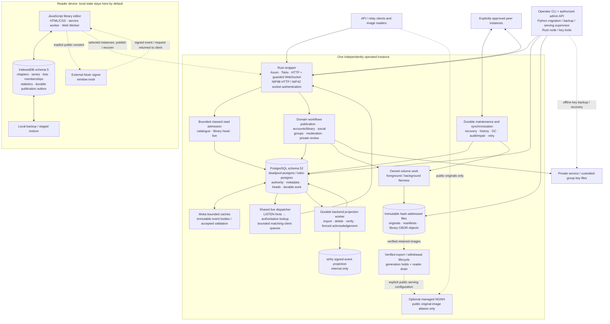

# manga-protocol architecture

Source-grounded map of the reconstructed application, reviewed 2026-10-11. This is an implementation map, not a production-capacity certificate or a complete MangaDex reader website. The [parity contract](PARITY-REQUIREMENTS.md) records recovered requirements; [canonical acceptance](../../results/rebuild-upload-final/canonical-acceptance.json), [native browser qualification](NATIVE-BROWSER-QUALIFICATION.md), and [load qualification status](../../results/rebuild-mixed-prep/STATUS.md) own their respective evidence. Older dated design documents can describe superseded behavior.

## Component and technology map

Solid arrows are implemented application paths. Dashed arrows are explicitly configured or user-selected paths, not implicit publication or automatic peer trust.

The diagram separates durable authority, immutable bytes, and derived projections. It does not imply that the browser editor currently provides every backend workflow as a screen, or that a generic object-storage service/CDN is deployed.

## Ownership and data boundaries

| Component | Owns | Does not establish |
| --- | --- | --- |
| Browser local library | Private local edits, exact record IDs, family statistics, local backup and queued publication bytes | Permission to publish merely because a save occurred |
| PostgreSQL repository | Account/peer/group authority, current heads, moderation, storage grants/holds, queues and leases | Physical file health or a completed external strfry/NGINX action without confirmation |
| Moka | Bounded immutable event-body and accepted-root validation reuse | Current authorization, visibility, object generation or health |
| strfry | Internal signed-event projection maintained by the wrapper | An alternate public policy authority or a store for image/manifests/library-object bytes |
| Local object volume | Verified immutable hash-addressed bytes and physical ownership | Public visibility without retained references, authorization and health checks |
| Managed NGINX | Direct reads of derived public original-image aliases | Access to staging, manifests, library objects, private submissions or keys |
| Peer connection | Verified transfer from an approved service identity and endpoint | Trust inferred from a URL in an event, discovery result or manifest |

The runtime stack is Rust 2024 / Rust 1.90, Axum, Tokio, PostgreSQL, deadpool-postgres/tokio-postgres and Moka. Rustls protects supported network/database paths; serde/ciborium and SHA-256/secp256k1 implement the relevant wire and signature boundaries. Browser source uses native JavaScript APIs and noble cryptography. Python supplies operator workflows and the managed-serving supervisor. There is no SQLx, SQLite application runtime or Kratos identity service in this architecture. See [server dependencies](../../server/Cargo.toml), [repository/migrations](../../server/src/db.rs), and [browser dependencies](../../browser-client/package.json).

## Main flows and failure ownership

### 1. Local save, explicit publication, recovery

- The browser's four record families are chapters, series, lists and list memberships. Schema 5 updates counts transactionally with records; opening/upgrading the database does not publish anything. IndexedDB owns transaction completion/abort, while cross-tab signals refresh views. See [store](../../browser-client/src/store.js), [IndexedDB adapter](../../browser-client/src/indexeddb.js), and [codec](../../browser-client/src/codec.js).
- Explicit consent and a selected signer turn a reviewed snapshot into immutable CBOR root/chunk objects and a signed public library-head event. The application does not capture a reader's private key. Web Locks, local-revision and recipient-selection fences prevent competing tabs or changed consent from silently publishing a different snapshot. See [publication](../../browser-client/src/publishing.js) and [signing/HTTP verification](../../browser-client/src/nostr.js).
- The bounded durable browser outbox retains immutable event/object bytes and per-recipient progress; cancellation/removal remains sticky. Retries deliver the queued snapshot rather than silently resigning current edits. Public recovery verifies identity, signatures, hashes and the complete graph before replacing local records. The native Rust client supplies analogous delivery/recovery operations. See [browser outbox](../../browser-client/src/outbox.js) and [Rust library client](../../server/src/library_client.rs).
- Local backups use bounded record/line processing and staged import with atomic replacement. Normal export can assemble a downloadable Blob from bounded parts; this is not a claim of constant total export storage. Over-budget legacy data has a separate streaming rescue path. Web Locks prevent abandoned-stage cleanup from deleting another tab's active import. See [backup lifecycle](../../browser-client/src/backup.js).
- One public library head per key uses replacement semantics; local state does not automatically merge globally. Loss of browser storage is addressed by an independently saved backup or an explicitly published, still-retained recoverable graph, not by treating IndexedDB as an unlimited durable cloud service.

### 2. Admission, reads and live events

- The wrapper is the public HTTP/WebSocket boundary. HTTP NIP98, WebSocket NIP42 and account/peer authorization remain distinct from an ordinary signature check. Configured public/authenticated/admitted read policies and current revocation checks apply at that boundary; the raw strfry listener must not be exposed. See [node routes/configuration](../../server/src/node.rs), [relay](../../server/src/relay.rs), and [authentication](../../server/src/auth.rs).
- Catalogue, library-head and live reads share an overall database read limit with independent active/waiting caps and bounded waiting. Class caps isolate contention; they are not strict reserved shares. Exhaustion returns a retryable busy response rather than creating unbounded database work. See [admission](../../server/src/read_admission.rs).
- An admitted HTTP task retains its credit until owned handler/SQL work actually completes, even after disconnect or an early deadline response. Long-lived download bodies own separate count/byte credits. Storage snapshots have independent read ownership, so held mutation capacity does not silently consume all observation capacity. See [HTTP lifetime](../../server/src/node/read_admission.rs), [download budgets](../../server/src/download_budget.rs), and [storage](../../server/src/storage.rs).
- PostgreSQL notifications are hints containing IDs, not authority. One shared dispatcher fetches an event once per processed notification and fans it out only to matching bounded queues. Sessions register before history; clients deduplicate signed IDs across the history/live boundary. Queue loss, notification discontinuity or unverifiable fetch closes affected continuity rather than pretending all events were delivered. Reconnect/resubscribe recovers through history; admission pressure gets a bounded wait. See [feed](../../server/src/relay_feed.rs), [dispatcher](../../server/src/relay_dispatch.rs), and [history query](../../server/src/relay_query.rs).

### 3. Publication, durable projection and reclamation

- Upload and library staging validate original/manifest/object bytes before reference retention. Expensive immutable-root preparation occurs outside the author transaction. Commit locks and rechecks current authority, exact generations, grants and health; a cache hit or prepared descriptor cannot adopt a reclaimed/restaged generation. A library-head read obtains head and visibility coherently. See [publication](../../server/src/publication.rs), [library references](../../server/src/library_references.rs), and [library view](../../server/src/library_view.rs).
- The PostgreSQL backend outbox bridges database commit and strfry import/delete/verification. Version/state-fenced acknowledgement follows verified external work; imports and bounded retirements preserve author-lock ordering. Raw kind-5 events do not enter strfry as an uncontrolled deletion instruction. Admission success and event-specific projection completion are not proof of a globally drained queue. See [backend](../../server/src/backend.rs) and [ordinary deletion](../../server/src/ordinary_deletion.rs).
- History cleanup removes eligible obsolete library event bodies in bounded transactions while preserving current heads, winner watermarks, pending work and holds. Object retirement, grace and exact-generation receipts precede physical/accounting completion. Grouped refunds remain one-time; unlink alone does not refund occupied or externally held bytes. See [history](../../server/src/library_history.rs), [reclamation](../../server/src/reclamation.rs), and [accounting](../../server/src/storage_accounting.rs).
- One volume-work scheduler limits foreground/background operations. Normal cleanup consumes a smaller allowance; low quota/filesystem headroom can raise it while preserving a foreground slot when total capacity exceeds one. A one-slot volume instead interleaves eligible work. Owned blocking I/O retains its permit after caller cancellation. Upload admission, mutation work, response bytes and physical storage quotas are separate budgets. See [storage fairness](STORAGE-FAIRNESS.md) and [scheduler](../../server/src/storage_admission.rs).

### 4. Originals and optional direct serving

- The baseline guarded HTTP path verifies metadata, generation and health before delivering bytes. Image originals, HTTP manifests and library CBOR objects have different routes and visibility rules; they are not embedded in the relay event stream. Original-image representation is JPEG/PNG/WebP, not an implemented image-transcoding/CDN pipeline.
- Optional managed NGINX serves only retained verified public image aliases. Its successful direct reads bypass Rust/PostgreSQL/Moka per request. The Python supervisor owns the exact reader process family; export holds and verified reader drain protect physical deletion/refund even after unlink. See [exports](../../server/src/public_exports.rs), [serving role](../../server/src/serving_role.rs), and [supervisor](../../src/serving_supervisor.py).
- Direct serving requires explicit configuration and public read policy. Initial backfill can leave verified HTTP available. An uncertain namespace, helper/master failure or unproven drain closes direct serving; recovery does not automatically reactivate it. Reviewed recovery/restart is required. HTTP remains a separate verified route, not a promise that the reverse proxy automatically reroutes failed NGINX requests. TLS proxy routing and deployment topology belong to the operator.

### 5. Federation, groups and moderation

- Approved service identities and endpoints govern peer transfer. Discovery does not grant approval; redirects and event-provided URLs cannot silently choose transfer destinations. Chapter/series fallback peers require their own approval. Other inventory families do not automatically inherit that fallback behavior. Scoped inventories and Negentropy reconciliation feed durable partitioned jobs with bounded queues, leases, retries and optional schedules. Cancellation fences future commits but does not roll back content already admitted. See [peers](../../server/src/peers.rs), [inventories](../../server/src/inventory.rs), [sync jobs](../../server/src/sync_jobs.rs), and [schedules](../../server/src/sync_schedules.rs).
- Managed groups use instance-custodied ordinary signing keys with live membership/role/version checks and audit. Offline key recovery preserves identity, not automatic membership approval on another instance. Profile clearing/reversible disabling is implemented; permanent group/key erasure is not the chosen MVP lifecycle. See [groups](../../server/src/groups.rs), [offline keys](../../server/src/offline_keys.rs), and [recovery contract](../group-key-backup-recovery.md).
- Protected chapter/series deletion uses local moderation; ordinary account/library/social deletion has its own workflow. Private submissions remain private pending authorized review and complete publication checks. Moderation cannot erase copies already held by unrelated peers. Profiles, comments/replies and signed reactions exist; aggregate vote ranking and proof of one-person-one-vote are separate unimplemented product features. See [moderation](../../server/src/moderation.rs), [private review](../../server/src/submission_review.rs), and [social](../../server/src/social.rs).

### 6. Operations and recovery

- Rust node CLI owns migration/startup; authorized admin HTTP exposes policy, status, storage audit/repair and job control. Named worker status distinguishes running/returned/cancelled/panicked, but a running task is not proof of progress. Durable queues and visible failures retain recovery responsibility. See [node CLI](../../server/src/main.rs) and [worker observation](../../server/src/background_workers.rs).
- Python migration tools consume reviewed mappings for a supported MangaDex-shaped subset and exact local-library records. Password/token import and unchanged arbitrary MangaDex-client compatibility are not provided. See [local migration](../../src/local_library_migration.py), [MangaDex migration](../../src/mangadex_migration.py), and [PostgreSQL migration](../../src/postgres_migration.py).
- Offline operator backup/restore validates bounded manifests, paths and copied hashes, preserves needed identity/state, and restores with serving/signup/recurring sync paused for review. Private artifacts use restrictive modes and atomic publication. Key backups are a separate sensitive offline workflow. Public project checkpoints exclude credentials, private keys, personal data and runtime databases; source archives alone are not an operational-data backup. See [backup tool](../../src/postgres_backup.py), [operator artifact boundary](../../src/operator_json.py), [operator notes](OPERATOR.md), and [checkpoint index](CHECKPOINTS.json).

## Implemented, optional and deferred

- **Implemented core:** guarded protocol/API, catalogue and compatibility subset, immutable originals/manifests, local-first browser library, explicit public library publication/recovery, durable queues, approved-peer synchronization, group custody, moderation/private review, admission/fairness, accounting/reclamation and operator recovery tooling.
- **Implemented but optional/configured:** public browser publication, managed NGINX direct originals, reader enrollment, approved peer jobs/schedules, native client delivery and offline migrations. Their presence in source does not enable them implicitly or authorize a recipient.
- **Deferred frontend:** catalogue search/browse and chapter-image reader, social/group publishing screens, review/moderator console. Backend availability does not make this a full MangaDex-style reader UI.
- **Separate qualification:** target traffic and retained-storage scale, production security/operations, physical-device eviction/power-loss behavior and native signing-extension end-to-end coverage. Benchmark evidence belongs to the linked reports; this diagram makes no sustained-capacity claim.
- **Parity limit:** the recovered requirements and observable interfaces can be checked; missing later source prevents a byte-for-byte reconstruction claim. This source review found no additional absent required core feature family, but it does not replace executable acceptance or prove every failure mode.
